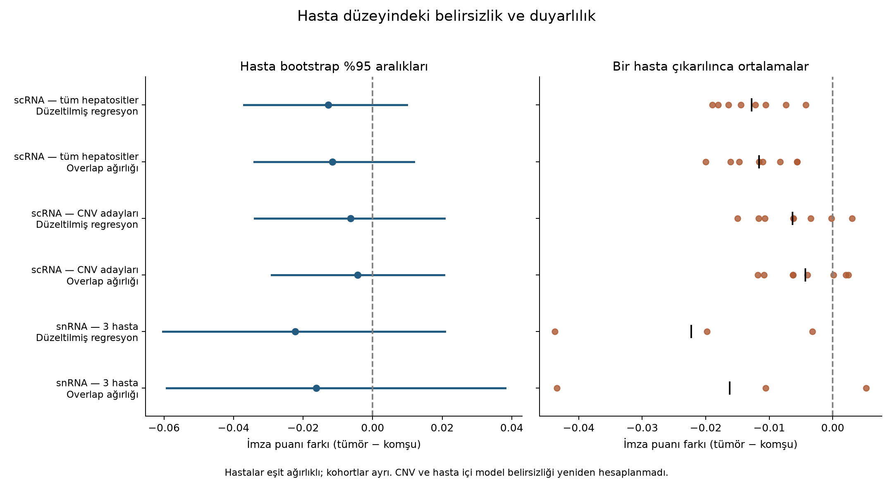
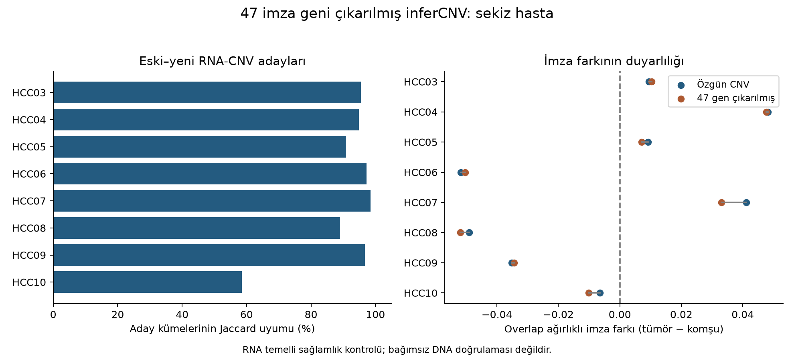

# HCC migration signature under patient and model sensitivity

**A research project by Aydın Utku Çetiner**

A migration-associated hepatocyte signature derived from human liver injury was re-examined in hepatocellular carcinoma. The question was whether tumour–adjacent differences remained coherent after covariate adjustment, RNA-derived malignancy candidate selection and patient-level sensitivity analysis.

They did not support a general, one-direction increase. That finding does not prove absence of an association. It defines the limit of the current evidence.

This is an exploratory computational research portfolio. It is not a peer-reviewed publication, a diagnostic classifier or a complete reproducibility release. The full unpublished manuscript remains in the private research archive.

## Evidence at a glance

| Analysis | Scope | Observation |
|---|---|---|
| Main scRNA cohort GSE149614 | Eight paired patients; 13,762 hepatocytes | Analysed within patients; patients receive equal weight in summaries |
| Separate snRNA cohort GSE189175 | Three paired patients; 25,977 hepatocyte-like nuclei | Kept separate; no malignancy classification in this cohort |
| Original RNA-CNV candidates | 10,508 tumour hepatocytes | Four positive and four negative overlap-weighted patient contrasts |
| inferCNV excluding 47 signature genes | All eight patients; two reference workflows each | 12,934 labels unchanged; 828 changed; 10,486 candidates |
| Candidate overlap mean after exclusion | Eight patients | −0.00609; patient bootstrap 95% interval [−0.02978, +0.01804] |
| Leave-one-patient-out sensitivity | Candidate overlap mean after exclusion | Mean becomes positive when HCC06 or HCC08 is omitted |

Differences are tumour minus adjacent tissue, in the mean log-normalized expression score of 47 genes. They are not percentages. Counts of cells do not replace independent patients.

## Patient uncertainty

The figure shows original-label analyses. Intervals resample patients while holding recorded within-patient contrasts fixed. They do not propagate all uncertainty in CNV selection, annotation or fitted weights. The three-patient snRNA distribution is particularly discrete. Intervals spanning zero do not demonstrate equivalence.

## Signature exclusion from CNV inference

The 47 genes were removed from CNV counts and genomic-order inputs. Cell sets, references and classification criteria were retained; signature scoring remained unchanged. HCC10 candidate-set Jaccard agreement was 58.5%, substantially below the other patients. A small net change in candidate count conceals hundreds of label changes.

This check reduces direct participation of signature genes in CNV inference. Removing genes also changes its normalization denominator. Shared RNA measurement biases remain; this is not independent DNA validation.

## Methods and research decisions

The analysis used sparse count processing, verified gene aliases, continuous cell-cycle and hepatocyte-identity scores, zonation controls, within-patient weighted regression, logistic propensity overlap weights, entropy balancing and quadratic-moment sensitivity. The snRNA lineage analysis used PCA, neighbour graphs, Leiden clustering and multiple lineage markers.

A restrictive joint range filter retained adequate paired support in only one of eight scRNA patients. Weighting allowed all eight comparisons, but did not restore information automatically: adjacent-tissue effective sample sizes remained below 20 for HCC05 and HCC07 in the signature-excluded candidate analysis. Near-exact mean balance does not guarantee joint support.

The Sharma archive was excluded from paired hepatocyte inference because the selected adjacent populations contained only 0–7 cells per patient. The source accession was corrected to GSE156337; GSE175111 was not used. This exclusion does not imply that the source tissue lacked hepatocytes.

[Read the methods and implementation scope](METHODS.md).

## Code and computational checks

[Download the 49-script source snapshot](HCC-analysis-scripts.zip). The archive contains the original project filenames under `work/`, with a source checksum manifest. It excludes raw counts, cell-barcode exports, large CNV objects, installed libraries and manuscript drafts.

Independent R calculations agreed with Python for all eight new candidate overlap contrasts, with maximum absolute difference below 8.63 × 10⁻⁹. All 16 final signature-excluded CNV objects retained their input cells and contained none of the 47 excluded genes. These checks test implementation agreement. They do not establish biological truth.

The snapshot requires original data and intermediate caches that are not included. It has not been rerun in a clean environment. It should be inspected as research code, not advertised as a single-command pipeline.

## Researcher contribution and AI assistance

Aydın Utku Çetiner directed the research question, analysis priorities and decisions to widen controls, separate cohorts, exclude unsuitable paired comparisons and require malignancy assessment before interpreting tumour-derived hepatocytes. AI assistance covered code generation, computational analysis, figures and manuscript drafting. No percentage of independently written code is claimed.

## Remaining work

CopyKAT has not been run. Independent DNA-based malignancy validation is unavailable. SoupX and intron/exon capture analyses were not performed because the required inputs were not available in the processed packages. Alternative signature-scoring methods and a portable, tested execution environment remain unresolved.

The project does not establish regeneration, a causal tumour mechanism, metastatic function or clinical utility.

## Sources

- [Human liver regeneration and source migration module — Matchett et al., Nature 2024](https://doi.org/10.1038/s41586-024-07376-2)
- [HCC single-cell atlas — Lu et al., Nature Communications 2022](https://doi.org/10.1038/s41467-022-32283-3) and [GSE149614](https://www.ncbi.nlm.nih.gov/geo/query/acc.cgi?acc=GSE149614)
- [Separate liver single-nucleus cohort — Alvarez et al., Genome Medicine 2022](https://doi.org/10.1186/s13073-022-01055-5) and [GSE189175](https://www.ncbi.nlm.nih.gov/geo/query/acc.cgi?acc=GSE189175)
- [Propensity overlap weighting — Li et al.](https://doi.org/10.1080/01621459.2016.1260466)
- [Entropy balancing — Hainmueller](https://doi.org/10.1093/pan/mpr025)
- [inferCNV official documentation](https://github.com/broadinstitute/infercnv/wiki/Running-InferCNV)
- [GENCODE human release 38](https://www.gencodegenes.org/human/release_38.html)

## Reuse and attribution

No reuse licence has been selected for this research snapshot. Source datasets and upstream software retain their own terms. Public availability does not make the work peer reviewed. Describe it as an exploratory project by Aydın Utku Çetiner and cite the original dataset and method publications when discussing their contributions.
